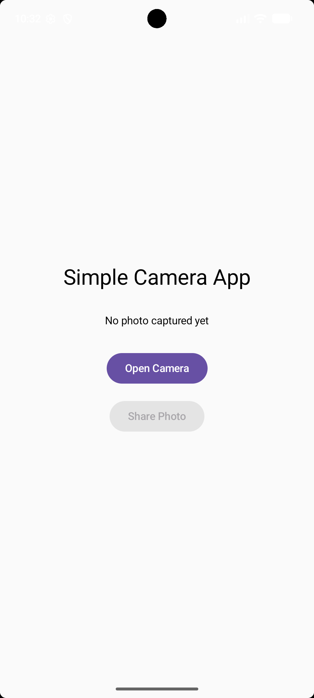
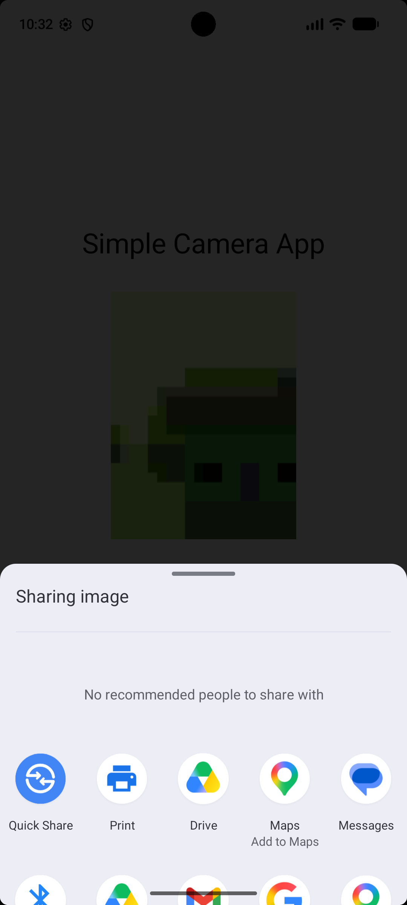

# 📸 Simple Camera Application

## 📌 Project Overview

Simple Camera Application is an Android mobile application developed using Kotlin and Jetpack Compose.

The application allows users to capture photos using the device's camera and view the captured images within the application.

## ✨ Features

* Camera permission handling.
* Open the device camera.
* Capture photos using the camera.
* Display captured images in the application.
* Simple and user-friendly interface.

## 🛠️ Technologies Used

* **Programming Language:** Kotlin
* **IDE:** Android Studio
* **UI Framework:** Jetpack Compose
* **Platform:** Android
* **Camera Integration:** Android Camera Intent
* **Permission Handling:** Android Runtime Permissions

## 📱 Application Screenshots

### Home Screen

### Captured Image

### Share Image

